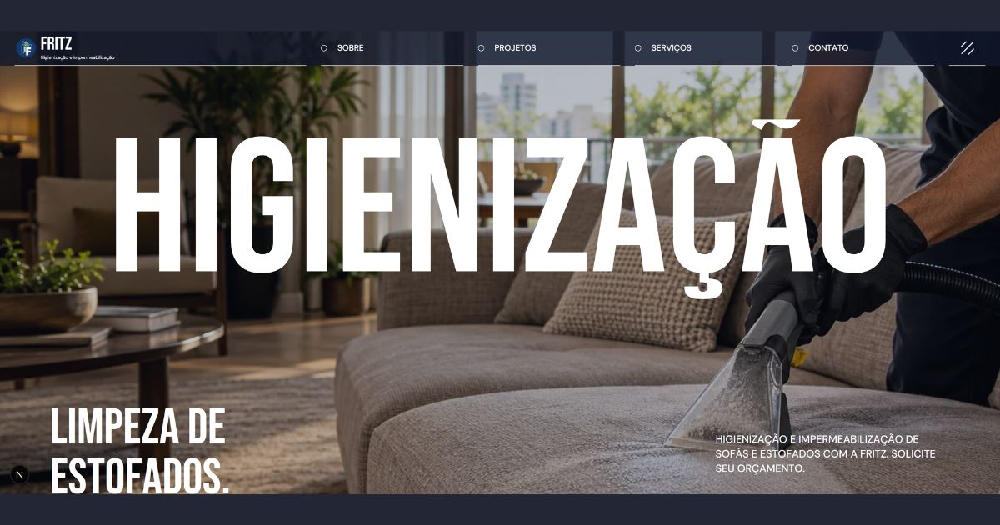
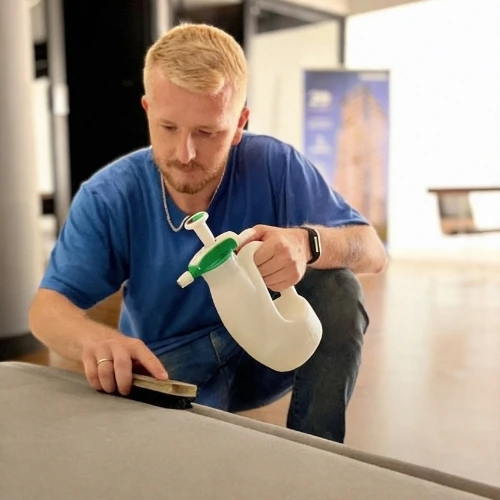
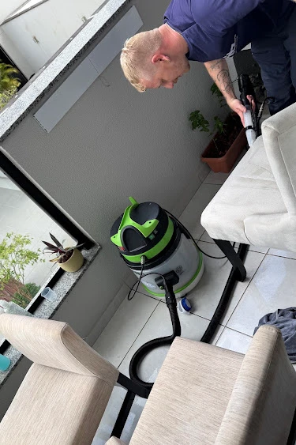

<div align="center">


# Fritz · Higienização e impermeabilização

**Cuidado com os estofados que fazem parte da sua vida.**

Site institucional para apresentar os serviços da Fritz, seus registros de atendimento e avaliações, com orçamento e dúvidas pelo WhatsApp.

[Visitar o site](https://higienizacaofritz.vercel.app/) · [Explorar a experiência](#experiência) · [Assistir ao vídeo](#vídeo) · [Executar localmente](#executar-localmente) · [Documentação](#documentação)

**Next.js 16 · React 19 · TypeScript · Tailwind CSS 4 · GSAP · Framer Motion**

</div>

[](https://higienizacaofritz.vercel.app/)

## Experiência

Uma interface com tipografia editorial, cores de gelo e azul, fotografias dos serviços e interações de rolagem. A navegação conecta apresentação, serviços, galeria, conteúdo educativo e contato direto.

| Página   | Conteúdo                                                         | Acesso                                                 |
| -------- | ---------------------------------------------------------------- | ------------------------------------------------------ |
| Início   | Serviços, etapas do atendimento, apresentação e avaliações       | [Abrir](https://higienizacaofritz.vercel.app/)         |
| Sobre    | Identidade, missão, visão, valores e áreas atendidas             | [Abrir](https://higienizacaofritz.vercel.app/sobre)    |
| Serviços | Higienização de estofados, colchões e tapetes; impermeabilização | [Abrir](https://higienizacaofritz.vercel.app/servicos) |
| Galeria  | Fotografias e registros relacionados ao atendimento              | [Abrir](https://higienizacaofritz.vercel.app/projetos) |
| Blog     | Cuidados, orientação sobre serviços e preparação do orçamento    | [Abrir](https://higienizacaofritz.vercel.app/blog)     |
| Contato  | Formulários de dúvidas e orçamento com mensagem para WhatsApp    | [Abrir](https://higienizacaofritz.vercel.app/contato)  |

A Galeria conserva a rota `/projetos` para manter os links existentes. Artigos e registros antigos possuem redirecionamentos permanentes para os conteúdos atuais.

<details>
<summary><strong>Explorar recursos e interações</strong></summary>

- Menu desktop e diálogo de navegação no mobile.
- Animações de entrada, transições e efeitos de rolagem.
- Cards de Missão, Visão e Valores com sobreposição progressiva no mobile.
- Etapas do atendimento com apresentação adaptada ao dispositivo.
- Quatro cards de avaliações com links para a fonte no Google.
- Vídeo com controles de reprodução e pausa.
- Botões de WhatsApp com contexto específico do serviço.
- Campo de observação no rodapé e formulários que incluem os dados preenchidos na mensagem.
- Imagens com variantes para mobile, tablet e desktop.
- Suporte à preferência de movimento reduzido e rótulos acessíveis nos controles.

Os formulários preparam uma mensagem no WhatsApp; o visitante confirma o envio. Não há envio de e-mail nem armazenamento de solicitações no site.

</details>

## Registros da Fritz

<table>
<tr>
<td width="50%"></td>
<td width="50%"></td>
</tr>
</table>

As fotografias acima fazem parte dos recursos utilizados na página Sobre. O site também contém imagens ilustrativas dos serviços, identificadas no conteúdo. As imagens de compartilhamento e o vídeo foram fornecidos para o projeto.

## Vídeo

[](https://higienizacaofritz.vercel.app/videos/fritz-showreel.mp4)

**[▶ Assistir ao vídeo](https://higienizacaofritz.vercel.app/videos/fritz-showreel.mp4)** · [Arquivo no repositório](public/videos/fritz-showreel.mp4)

O vídeo está em MP4, com resolução de 1920 × 1080, duração de aproximadamente cinco segundos e tamanho de aproximadamente 4 MB. Na interface, a reprodução utiliza `playsInline` e carregamento inicial de metadados. O enquadramento se adapta ao espaço disponível.

## Executar localmente

Requisitos: **Node.js `>=22.22.2 <23`** e **npm `11.15.0`**. Consulte também `.node-version` e `package.json`.

```powershell
git clone https://github.com/brunosilvamariano/higienizacaofritz.git
cd higienizacaofritz
npm ci
Copy-Item .env.example .env.local
npm run dev
```

Abra [localhost:3000](http://localhost:3000). Para uma porta alternativa:

```powershell
npm run dev -- --port 3002
```

<details>
<summary><strong>Build e execução de produção</strong></summary>

Pare o servidor de desenvolvimento antes de validar a produção na mesma pasta.

```powershell
npm run build
npm start
```

O build de produção foi concluído com sucesso no terminal local durante a validação do projeto. Essa validação não substitui executar os checks após novas alterações.

</details>

## Configuração

O Next.js carrega `.env.local` automaticamente. Esse arquivo é ignorado pelo Git; a lista de variáveis está em [.env.example](.env.example).

| Variável                               | Uso                                                                                          |
| -------------------------------------- | -------------------------------------------------------------------------------------------- |
| `SITE_URL`                             | Origem HTTPS para metadados, URLs canônicas e sitemap.                                       |
| `SITE_INDEXABLE`                       | `true` para produção; `false` para impedir indexação. Previews da Vercel não são indexáveis. |
| `GOOGLE_SITE_VERIFICATION`             | Verificação do site no Google, quando configurada.                                           |
| `META_DOMAIN_VERIFICATION`             | Verificação do domínio na Meta, quando configurada.                                          |
| `NEXT_PUBLIC_TRACKING_ENABLED`         | Habilita medição opcional quando existem identificadores configurados.                       |
| `NEXT_PUBLIC_GA4_ID`                   | Identificador do Google Analytics 4.                                                         |
| `NEXT_PUBLIC_GOOGLE_ADS_ID`            | Identificador do Google Ads.                                                                 |
| `NEXT_PUBLIC_GOOGLE_ADS_CONTACT_LABEL` | Rótulo da conversão de contato.                                                              |
| `NEXT_PUBLIC_META_PIXEL_ID`            | Identificador do Meta Pixel.                                                                 |
| `NEXT_PUBLIC_PRIVACY_URL`              | URL da política de privacidade utilizada pela integração de consentimento.                   |

A medição permanece desabilitada por padrão. As integrações seguem as escolhas de consentimento por categoria.

## Qualidade e validação

| Comando                | Finalidade                                   |
| ---------------------- | -------------------------------------------- |
| `npm run lint`         | Verificar regras do Biome.                   |
| `npm run typecheck`    | Validar tipos do TypeScript.                 |
| `npm run format:check` | Conferir formatação com Prettier.            |
| `npm run check`        | Executar lint, tipos e formatação.           |
| `npm test`             | Executar testes unitários.                   |
| `npm run build`        | Gerar a aplicação de produção.               |
| `npm audit`            | Consultar vulnerabilidades das dependências. |

<details>
<summary><strong>Auditoria HTTP das páginas e recursos</strong></summary>

Com uma instância local em execução:

```powershell
node scripts/audit-fritz.cjs http://localhost:3000
```

O script verifica páginas públicas, redirecionamentos, recursos de imagem e vídeo, metadados de compartilhamento, sitemap e dados estruturados. Na revisão local, foram validados 16 endereços públicos, dez redirecionamentos e 29 recursos de imagem. Os 25 testes unitários passaram.

Esses resultados não representam uma nota Lighthouse nem uma medição de conversão comercial.

</details>

## Estrutura

```text
src/
├── app/          Rotas, composição de páginas e metadados
├── sections/     Conteúdo, estilos e interações por seção
├── components/   Interface, navegação, mídia e componentes compartilhados
├── animations/   Utilitários de animação
├── config/       Site, contatos, navegação, SEO e medição
├── content/      Artigos, registros e avaliações
├── assets/       Imagens e fontes locais
├── lib/          Utilitários e integrações
└── styles/       Tokens, base visual e integração com Tailwind
public/videos/    Vídeo de apresentação
scripts/          Auditoria HTTP
tests/unit/       Testes unitários
docs/             Guias e decisões do projeto
```

Fontes locais: **Bebas Neue e DM Sans**. Estilos híbridos: Tailwind com prefixo `tw:` para layout simples e CSS por seção para composição, estados e responsividade.

## Publicação e SEO

O projeto usa a Vercel. Configure as variáveis de produção antes do deploy:

```dotenv
SITE_URL=https://higienizacaofritz.vercel.app
SITE_INDEXABLE=true
```

Após publicar, confira as páginas, os formulários, o vídeo, [robots.txt](https://higienizacaofritz.vercel.app/robots.txt) e [sitemap.xml](https://higienizacaofritz.vercel.app/sitemap.xml).

O SEO inclui títulos e descrições por página, URL canônica, Open Graph, Twitter e dados estruturados `LocalBusiness` com serviços e cidades atendidas. A imagem social tem 1200 × 630 pixels. Plataformas de compartilhamento podem manter a prévia anterior em cache.

## Documentação

- [Índice dos guias](docs/README.md)
- [Arquitetura](docs/guias/arquitetura.md)
- [Direção visual e decisões](docs/guias/design-brief.md)
- [Organização por seção](docs/guias/secao-modelo.md)
- [Tailwind e CSS](docs/guias/tailwind-e-css.md)
- [Dependências](docs/guias/dependencias.md)
- [Registro da auditoria inicial](docs/guias/auditoria-fritz.md)

O registro da auditoria preserva o diagnóstico feito naquele momento. O bloqueio de build documentado foi posteriormente superado na execução pelo terminal do usuário.

## Créditos e uso dos recursos

Desenvolvimento: [VBG Agency](https://vbg-agency.vercel.app/).

Os textos, a identidade da Fritz, fotografias, avaliações e vídeos possuem origens e direitos próprios. Sua presença neste repositório não concede autorização geral de redistribuição. As licenças das fontes permanecem junto aos arquivos locais.
